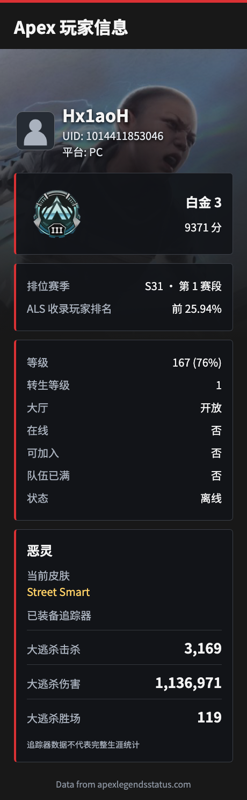
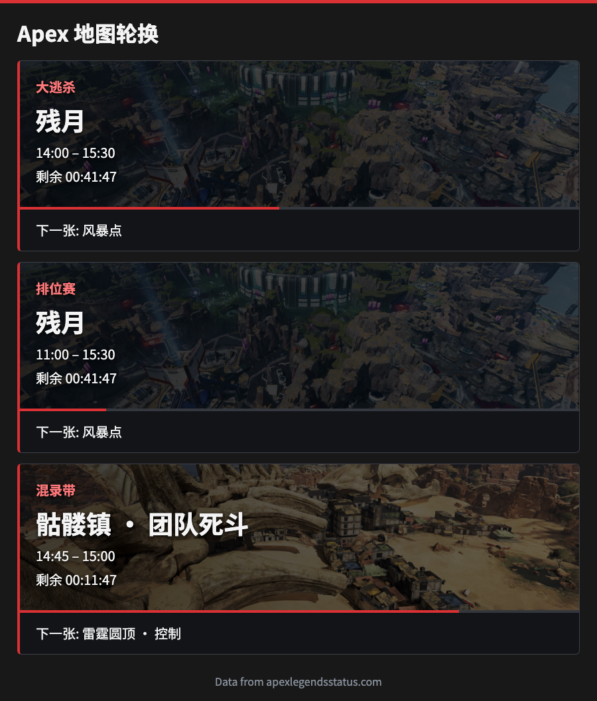
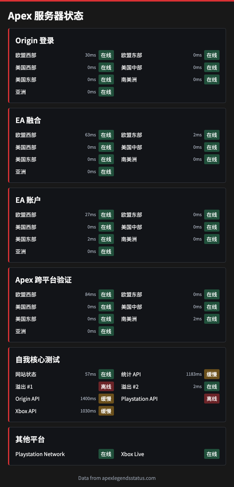
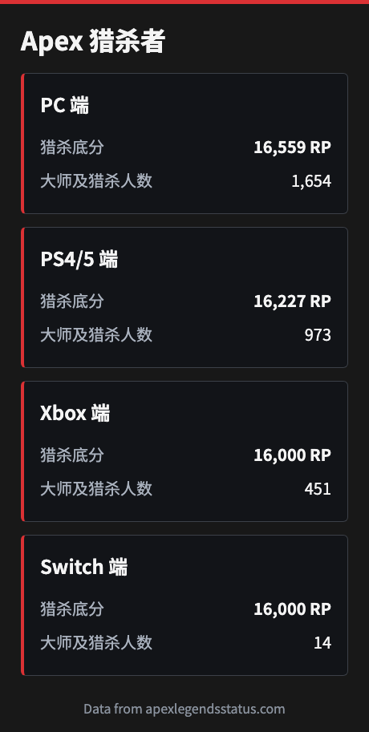

<div align="center">
  <a href="https://v2.nonebot.dev/store">
    
  </a>
</div>

<div align="center">

# NoneBot-Plugin-Apex-API-Query

_在 NoneBot 中查询 Apex Legends 玩家战绩、地图轮换、服务器状态和顶猎分数。_

<a href="https://registry.nonebot.dev/plugin/nonebot-plugin-apex-api-query:nonebot_plugin_apex_api_query">
  
</a>

</div>

## 📖 介绍

通过 [Apex Legends API](https://apexlegendsstatus.com/) 获取数据，默认回复图片卡片，也可设置为纯文本。

- 查询玩家数据，与上次记录对比等级、排位分数和段位
- 按聊天用户绑定玩家名称或 UID，绑定后发送 `/apex` 即可查询
- 玩家卡片使用当前传奇背景，展示转生等级、通行证等级、排位赛季、ALS 收录排名、皮肤和已装备追踪器（有数据时显示；追踪器不代表完整生涯统计）
- 查询地图轮换（大逃杀 / 排位赛 / 混录带）
- 查询各分区服务器运行状态
- 查询各平台顶尖猎杀者排行分数

在 [API 门户](https://portal.apexlegendsapi.com/) 申请密钥，按要求[关联 Discord 账户](https://portal.apexlegendsapi.com/discord-auth)，再回到[门户](https://portal.apexlegendsapi.com/)登录并测试密钥。

> 按名称查询 PC 玩家时，请使用 EA 账户用户名，Steam 名称不适用。
>
> 战绩数据由 API 提供，插件负责查询、保存历史和生成卡片。

## 💿 安装

<details>
<summary>使用 nb-cli 安装</summary>

在 NoneBot2 项目根目录运行：

```shell
nb plugin install nonebot_plugin_apex_api_query
```

</details>

<details>
<summary>使用包管理器安装</summary>

在 NoneBot2 项目使用的 Python 环境中，选择对应的包管理器安装：

<details>
<summary>pip</summary>

```shell
pip install nonebot_plugin_apex_api_query
```
</details>

<details>
<summary>poetry</summary>

```shell
poetry add nonebot_plugin_apex_api_query
```
</details>

安装后，在项目根目录的 `pyproject.toml` 中将插件加入 `[tool.nonebot]` 的 `plugins` 列表；已有其他插件时保留原列表：

```toml
plugins = ["nonebot_plugin_apex_api_query"]
```

</details>

## ⚙️ 配置

在 NoneBot2 项目的 `.env` 中填写 API 密钥，其他配置按需添加：

| 配置项 | 类型 | 必填 | 默认值 | 说明 |
|--------|------|------|--------|------|
| `APEX_API_KEY` | str | **是** | `""` | Apex API 密钥，必须填写 |
| `APEX_API_URL` | str | 否 | `https://api.apexlegendsstatus.com` | API 地址（玩家/地图/服务器/顶猎共用） |
| `APEX_ONLY_TEXT` | bool | 否 | `False` | 是否仅使用纯文本输出（不渲染图片） |

示例：

```env
APEX_API_KEY = "你的 API 密钥"
# 以下均为可选配置
APEX_ONLY_TEXT = False
```

> `APEX_API_KEY` 不能省略、留空或只填空格，否则插件无法加载。设置 `APEX_ONLY_TEXT = True` 后，所有查询仅返回文字，不渲染卡片。

插件通过 Alconna 的统一消息接口适配其支持的平台。图片无法导出或发送时，会自动回复完整查询文字；Console 等不支持图片的平台也可使用。各平台仍需安装、配置并连接对应适配器，图片收发效果需在实际平台验证。

### HTML 卡片渲染

四类卡片均使用 `nonebot-plugin-htmlrender` 0.8 的 Playwright 后端，模板位于插件包的 `templates/`。安装插件时会安装 Python 渲染依赖；首次渲染还需要可用的 Chromium（htmlrender 默认会下载并管理浏览器），部署环境需要允许下载并具备浏览器所需的系统库。

玩家背景优先使用 API 图片；变幻、艾克赛尔和硫雀的 API 背景不可用时，使用 EA 官方角色素材。背景均不可用时保留纯色，头像不可用时显示默认头像；404/410 图片链接会缓存一小时，避免重复请求。

在机器人入口的 `nonebot.init()` 中配置后端，并授权读取本插件的模板目录：

```python
from importlib.util import find_spec
from pathlib import Path

import nonebot

plugin_dir = Path(find_spec("nonebot_plugin_apex_api_query").origin).parent
nonebot.init(
    render={
        "provider": "playwright",
        "resources": {
            "local_access": {"allowed_paths": [str(plugin_dir)]},
        },
    },
)
# 继续注册适配器、加载插件，最后调用 nonebot.run()
```

已有 `render` 配置时，将插件目录追加到原来的 `allowed_paths`，保留其他插件的设置。不要重复调用 `nonebot.init()`。仅使用 `APEX_ONLY_TEXT=True` 时无需启动浏览器；渲染失败时也会回退为文字。

### 历史数据与缓存

玩家历史和绑定信息都通过 `nonebot-plugin-orm` 保存。插件包含 SQLite 驱动，无需另配数据库即可使用；默认数据库是 `nonebot-plugin-localstore` 管理的 ORM 数据目录下的 `db.sqlite3`。已有 `SQLALCHEMY_DATABASE_URL` 或 ORM 默认连接配置时继续使用原数据库，不移动历史记录。可用 localstore 的 `LOCALSTORE_USE_CWD=True` 将数据保存在机器人工作目录。

玩家等级变化按转生层级和等级共同计算，跨转生升级也会显示正确增量。升级后 ORM 会同步新增可空的 `prestige` 字段；旧记录缺少转生层级时，首次查询只对比分数和段位，之后恢复等级比较。升级前应备份机器人数据库。

同一进程内，同一玩家及平台的历史读取和保存按顺序执行；记录时间采用查询开始时间，较早发起却较晚返回的查询不写入历史，也不生成变化对比。地图、服务器和顶猎分别缓存 60 秒、30 秒和 5 分钟，并发查询共用请求；失败结果不缓存。可选图片下载设有每张 10 秒的总时间预算。

### 开发测试

```bash
poetry install --with dev
poetry run python -m unittest discover -s tests -v
```

测试包含真实插件加载、旧 SQLite 表兼容、历史对比、并发查询及 Console 消息处理，不需要真实 API 密钥或浏览器。PR 和 main 推送均运行测试，全部通过后才允许 main 发布。

## 🎉 使用

### 指令表

| 指令 | 说明 |
|------|------|
| `apex <玩家名称> [平台]` | 查询玩家信息（默认 PC 平台） |
| `apex` | 查询自己已绑定的玩家 |
| `apex bind <玩家名称> [平台]` / `apex 绑定 <玩家名称> [平台]` | 按名称绑定或更换账号 |
| `apex binduid <UID> [平台]` / `apex 绑定UID <UID> [平台]` | 按 UID 绑定或更换账号 |
| `apex bind` / `apex 绑定` | 查看自己的绑定 |
| `apex unbind` / `apex 解绑` | 解除自己的绑定 |
| `apex m` / `apex map` / `apex 地图` | 查询地图轮换 |
| `apex s` / `apex server` / `apex 服务器` | 查询服务器状态 |
| `apex p` / `apex predator` / `apex 顶猎` | 查询顶猎分数 |

支持的平台参数：`PC`、`PS4`、`X1`、`SWITCH`

所有命令支持 `/apex` 和 `.apex` 前缀。绑定命令默认使用 PC 平台，Switch 玩家请使用 UID 绑定。

发送 `/apex bind Hx1aoH PC` 或 `/apex binduid 1014411853046 PC` 完成绑定，之后直接发送 `/apex` 查询。插件先验证 API 数据，验证失败会保留原绑定。绑定成功后保存名称、UID 和游戏平台，后续按 UID 查询，玩家改名后更新显示名称。纯数字名称用 `bind`，UID 用 `binduid`。

每个聊天用户在同一机器人内绑定一个账号，群聊和私聊共用，重启后保留。绑定验证、保存与解绑按同一用户的请求顺序执行。再次绑定会替换旧绑定；临时查询其他玩家和解绑均不删除历史战绩。不同用户、机器人及底层聊天平台互相隔离。绑定只保存公开战绩的查询偏好，不验证游戏账号归属。

## 🖼️ 效果

以下为当前卡片样式的查询示例，图片中的战绩、地图和服务器状态仅代表截图时的数据。设置 `APEX_ONLY_TEXT=True` 可改为文字输出。

### 玩家查询



### 地图轮换



### 服务器状态



### 顶猎排行



## 💖 鸣谢

- [@nonebot](https://github.com/nonebot) [NoneBot2](https://github.com/nonebot/nonebot2) 机器人框架
- [@ProgramRipper](https://github.com/ProgramRipper) 数据库支持插件 [orm](https://github.com/nonebot/plugin-orm)
- [@yanyongyu](https://github.com/yanyongyu) 本地数据存储插件 [LocalStore](https://github.com/nonebot/plugin-localstore)
- [@anomalyco](https://github.com/anomalyco) 开源 AI Coding Agent [Opencode](https://github.com/anomalyco/opencode)
- [@deepseek-ai](https://github.com/deepseek-ai) 探索未至之境 [Deepseek](https://www.deepseek.com)

## 📄 许可证

本项目使用 [MIT](./LICENSE) 许可证开源。
